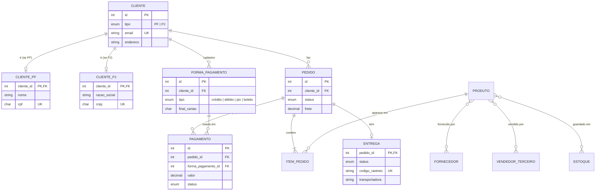

# E-commerce: projeto lógico em MySQL

Desafio "Construindo seu Primeiro Projeto Lógico de Banco de Dados", da formação SQL Database Specialist da DIO. O objetivo é levar o modelo conceitual do e-commerce, já com os refinamentos do módulo anterior, para o modelo relacional: criar o banco com chaves e restrições, popular com dados de teste e escrever consultas que respondam perguntas de negócio.

Refinamentos que precisavam aparecer no modelo lógico:

- **Cliente PF ou PJ**, nunca os dois;
- **mais de uma forma de pagamento** por cliente;
- **entrega** com status e código de rastreio.

## Esquema




## Do EER para tabelas

**Especialização PF/PJ (disjunta).** Virou uma tabela `cliente` com o discriminador `tipo` e uma tabela para cada especialização (`cliente_pf`, `cliente_pj`), que usam o id do cliente como chave primária. Para a especialização ser realmente disjunta, a chave estrangeira das filhas é composta (`cliente_id`, `tipo`) e cada uma só aceita o próprio tipo. Um cliente PF não tem como aparecer em `cliente_pj`.

**Relacionamentos N:M.** Produto–fornecedor, produto–vendedor terceiro, produto–estoque e pedido–produto viraram tabelas associativas com chave composta. As que têm atributo próprio guardam esse atributo: quantidade em estoque, quantidade vendida e o preço unitário do momento da compra em `item_pedido`.

**Formas de pagamento.** O cliente cadastra várias (`forma_pagamento`) e cada pedido registra quanto foi pago com cada uma (`pagamento`). Um trigger impede pagar um pedido com a forma de outro cliente.

**Entrega (1:1 com pedido).** A chave de `entrega` é o próprio `pedido_id`. Status em `ENUM`, código de rastreio único, e uma restrição impede que o pedido saia de "preparando" sem código.

**Valores derivados.** O total do pedido não é coluna: vem da view `vw_pedido_total` (itens + frete), para nunca ficar desatualizado.

## Consultas

Todas em `sql/03_consultas.sql`. As quatro primeiras são as perguntas sugeridas no desafio.

| # | Pergunta | Cláusulas |
| --- | --- | --- |
| 1 | Quantos pedidos cada cliente fez, e quanto gastou? | junções, `GROUP BY`, derivado, `ORDER BY` |
| 2 | Algum vendedor também é fornecedor? | junção pelo CNPJ |
| 3 | Relação de produtos, fornecedores e estoques | várias junções |
| 4 | Nomes dos fornecedores e dos produtos de cada um | junção, `GROUP_CONCAT` |
| 5 | Quais produtos custam mais de R$ 100? | `WHERE`, `ORDER BY` |
| 6 | Quais produtos têm 100 unidades ou mais em estoque, somando os locais? | `GROUP BY`, `HAVING` |
| 7 | Subtotal, frete, total e preço médio por item de cada pedido | atributos derivados |
| 8 | Quais clientes PJ compraram mais de R$ 1.000? | junções, `HAVING` |
| 9 | Como cada cliente costuma pagar? | agregação condicional |
| 10 | Quanto tempo as entregas concluídas levaram? | `WHERE`, `TIMESTAMPDIFF` |

## Rodando

Com um MySQL 8 disponível:

```bash
./testar.sh -u root -p
```

O script recria o banco `ecommerce`, carrega os dados, roda as consultas e depois `tests/verificacoes.sql`, que tenta violar cada regra (cliente PF com CNPJ, cartão sem final, pagamento com forma de outro cliente, entrega sem rastreio...) e confere algumas respostas das consultas. O GitHub Actions repete isso num MySQL 8 a cada push.
